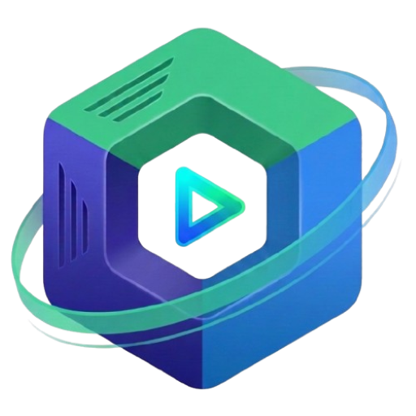
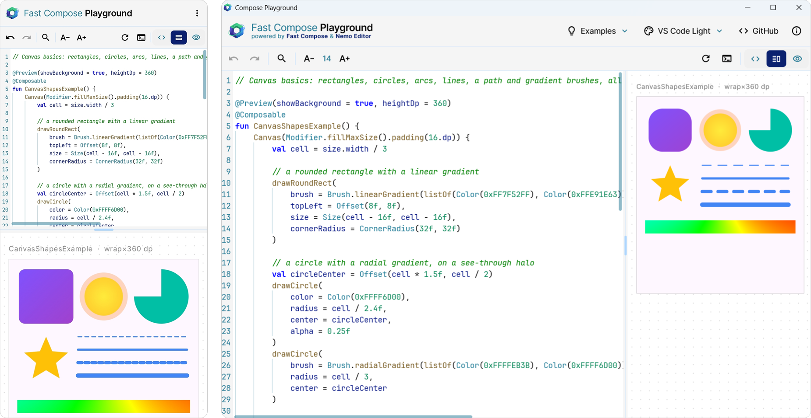

# Fast Compose Playground

### Write Jetpack Compose and see it live

No compiler, no build: every `@Preview` updates as you type.

**[Open the web version](https://fast-compose.github.io/playground/)** ·
**[Desktop downloads](https://github.com/fast-compose/playground/releases/latest)**

## What it does

**Live previews**: the code runs as you type, with Material 3, icons and network images.

**Examples**: 21 ready-made playgrounds of components, dialogs and sheets, animations and gestures, and Canvas
drawing.

**Code, split or preview**: show the editor, the preview, or both. Drag the bar between them to resize the panes;
double click it to reset them.

**Editor**: undo, redo, search, format, font size and autocomplete. Lines with errors are highlighted, and the logs open
when there are problems; click an error to jump to its line.

**Themes**: every [nemo-editor](https://github.com/Ma7moud3ly/nemo-editor) theme paints the whole app. VS Code
Light is the default.

**Share** (web): copy a link that opens the playground with both panes. On the web the page address always holds the
code, theme, font size and layout, so a reload or a link brings them back.

**Phones and wide screens**: on a narrow screen the panes are stacked and the buttons are smaller.

## Get it

| Platform | Where |
|---|---|
| Web | [fast-compose.github.io/playground](https://fast-compose.github.io/playground/), nothing to install |
| Android 7.0+ | [Google Play](https://play.google.com/store/apps/details?id=ma7moud3ly.fast.compose.playground), or the APK on [GitHub releases](https://github.com/fast-compose/playground/releases/latest) |
| Windows, macOS, Linux | `.msi`, `.dmg` and `.deb` installers on [GitHub releases](https://github.com/fast-compose/playground/releases/latest) |

> The web app needs a browser with WebAssembly garbage collection: a recent Chrome, Edge, Firefox or Safari.

The Google Play version sends crash reports and anonymous usage statistics through Firebase; the web, desktop and
GitHub APK versions send nothing. See the [privacy policy](privacy-policy.md).

To build the app yourself, see [docs/BUILDING.md](docs/BUILDING.md).

## Built with

- [Fast Compose](https://github.com/fast-compose/fast-compose): parses and runs the Compose code
- [nemo-editor](https://github.com/Ma7moud3ly/nemo-editor): the code editor, its themes and search
- [Compose Multiplatform](https://www.jetbrains.com/compose-multiplatform/)
- [Multiplatform Settings](https://github.com/russhwolf/multiplatform-settings): remembers the last playground
- [Firebase Crashlytics and Analytics](https://firebase.google.com/): crash reports, in the Google Play version only
- [JetBrains Mono](https://www.jetbrains.com/lp/mono/) and [Inter](https://rsms.me/inter/): the fonts of the code and
  of the app

## License

Compose Playground is released under the [Apache License 2.0](LICENSE). The bundled fonts keep their own license, the
SIL Open Font License: [JetBrains Mono](licenses/JetBrainsMono-OFL.txt) and [Inter](licenses/Inter-OFL.txt).
